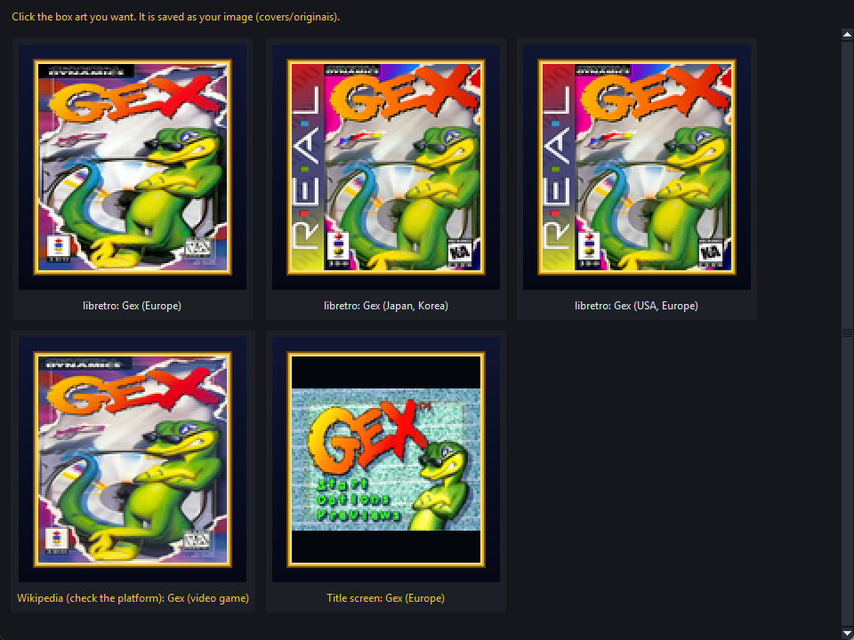
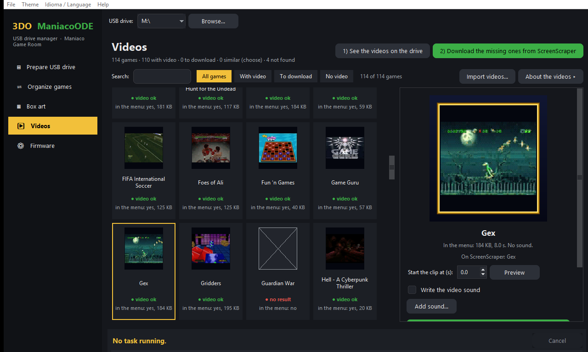
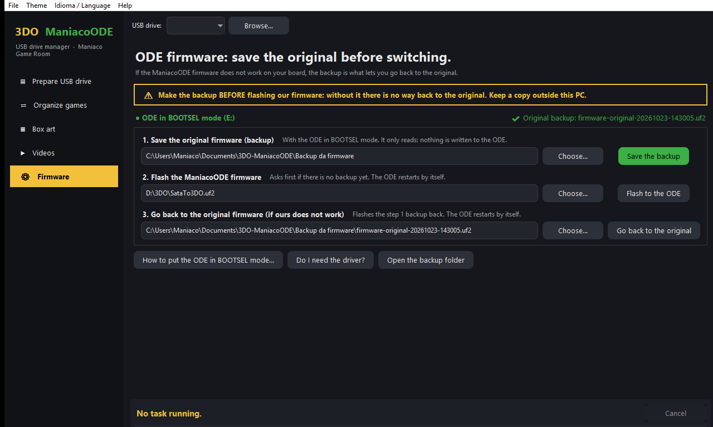
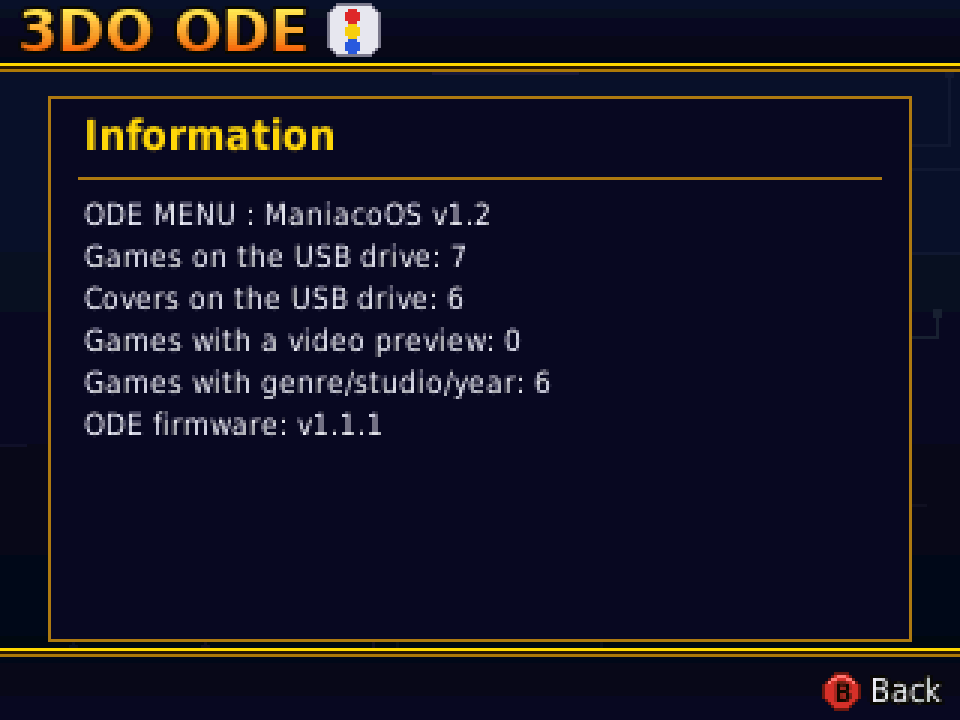

# Manual — 3DO ManiacoODE

**[Português](MANUAL.md)** · **[Back to start](README.en.md)**

The menu and the PC program can be used in English: on the console, **Options → "Idioma / Language"**; in the program, the **Idioma / Language** menu.

## Contents

1. [What you need](#1-what-you-need)
2. [First firmware install](#2-first-firmware-install)
3. [Preparing the USB drive](#3-preparing-the-usb-drive)
4. [PC program — USB drive manager](#4-pc-program--usb-drive-manager)
5. [Using the menu](#5-using-the-menu)
6. [Options](#6-options)
7. [Save manager](#7-save-manager)
8. [FZ-EM256 Memory Unit](#8-fz-em256-memory-unit)
9. [Updating the firmware](#9-updating-the-firmware)
10. [Troubleshooting](#10-troubleshooting)

## 1. What you need

- A 3DO with the **SataTo3DO ODE** (RP2040 board) installed. Tested on a **Panasonic FZ-10**.
- A USB drive formatted as **FAT32** or **exFAT**.
- The files from the **[Releases](../../releases)** page:
  - **`SataTo3DO.uf2`** — the ODE firmware;
  - **`boot.iso`** — the menu;
  - **`3DO-ManiacoODE-Gerenciador.exe`** — the PC program that prepares the USB drive (optional, for **Windows 10 or 11**).

## 2. First firmware install

> ⚠️ **Before flashing our firmware, save your ODE's original firmware.** If ManiacoODE does not work on your board, the backup is what lets you **go back to the original firmware**. Without it there is no way back. The PC program makes the backup in one click ([section 4.8](#48-ode-firmware-backup-and-way-back-to-the-original)); keep a copy of the file outside the PC too (cloud or USB drive).

Only the first time, flash the firmware from a PC. The easiest way is the PC program's **Firmware** screen ([section 4.8](#48-ode-firmware-backup-and-way-back-to-the-original)), which does the three steps below with warnings. By hand:

1. **BOOTSEL mode.** With the console **off**, connect the ODE's RP2040 to the PC over USB while holding the board's BOOTSEL button. The PC shows a drive named **RPI-RP2**.
2. **Back up the original (do not skip).** With the ODE still in BOOTSEL, save the whole flash with Raspberry Pi's `picotool`: `picotool save -a firmware-original.uf2`. Check the file (the `.uf2` is twice the flash size: 4 MB for an ODE with 2 MB of flash) and keep it in two places. In the program's Firmware screen the same step is the **Save the backup** button.
3. **Flash ManiacoODE.** Copy **`SataTo3DO.uf2`** to the **RPI-RP2** drive. The board writes it and restarts on its own.

After that, updates go through the USB drive ([section 9](#9-updating-the-firmware)).

**If ours does not work on your board:** put the ODE in BOOTSEL mode again and copy your `firmware-original-….uf2` (the backup from step 2) to the **RPI-RP2** drive. The board writes it and restarts with the original firmware. In the program's Firmware screen: **Go back to the original**.

## 3. Preparing the USB drive

The easiest way is the **PC program** ([section 4](#4-pc-program--usb-drive-manager)): it installs the menu, organizes the games, makes the box art and creates the saves folder in a few clicks.

If you prefer to do it by hand, lay out the USB drive like this:

```
boot.iso                 ← the menu
saves/                   ← folder for save backups (create it empty)
Alone in the Dark/
    Alone in the Dark.iso
Gex/
    Gex.iso
Policenauts/
    Policenauts (Disc 1).iso
    Policenauts (Disc 2).iso
```

- **`boot.iso`** goes in the root. If you had another menu, rename the old one (e.g. `boot_old.iso`) so you can go back.
- **Each game in its own folder.** A folder with a single game is shown with the **folder name**; with several files, each file name is shown.
- Supported formats: **`.iso`** (2048 or 2352 bytes per sector) and **`.cue` + `.bin`** (a single `.bin` per `.cue`). **`.chd`** games are converted to `.cue` + `.bin` by the PC program while copying ([section 4.2](#42-prepare-usb-drive)).
- **Multi-disc** games: keep "Disc 1", "Disc 2"… in the file name and the menu shows "(Disc 1)", "(Disc 2)".
- The **`saves`** and **`covers`** folders are not shown in the game list.
- The **box art** and the game info (genre, studio and year) are made by the PC program.
- **To change a game's name**, use **Rename game…** in the PC program ([section 4.4](#44-box-art)). If you rename the folder in Windows, the game still works (and saves are not lost), but the box art, the info and your chosen image keep the old name until you write the box art again.
- **Avoid renaming or moving many folders at once in the root of the USB drive.** On FAT32 every changed name leaves a deleted entry in the directory, and the ODE builds the game list by walking that directory before telling the 3DO there is a disc. With a directory full of deleted entries, the 3DO may give up and show its own screen instead of the menu ([section 10](#10-troubleshooting)).

## 4. PC program — USB drive manager

**3DO ManiacoODE — USB drive manager** gets the USB drive ready for the 3DO: it installs the menu, copies the firmware, organizes the games the way the ODE reads them, makes the box art, writes the video previews and creates the saves folder.

**Installation:** there is none. Download `3DO-ManiacoODE-Gerenciador.exe` from the [Releases](../../releases) page and open it.

> The first time, Windows may show "Windows protected your PC" (SmartScreen), because the program is new and has no paid signature. Click **More info → Run anyway**.

**Internet:** box art, game info and videos are downloaded when needed and kept on the PC (`%LOCALAPPDATA%\3DO-ManiacoODE`). From then on, what was already downloaded works offline.

**Your USB drive is safe:** the program **deletes nothing**. The old `boot.iso` is kept, repeated games go to the `_duplicados` folder, replaced images go to `covers/originais/_antigas`, and the game organization can be undone.

### 4.1 The window


- **Sidebar** (left): the five screens — **Prepare USB drive**, **Organize games**, **Box art**, **Videos** and **Firmware** (backup of the original firmware, [section 4.8](#48-ode-firmware-backup-and-way-back-to-the-original)); the open one is highlighted. At the bottom you see the state of the drive: file system, free space and whether the menu is installed.
- **USB drive** (top): pick the drive letter. The program suggests the drives that already have `boot.iso` first. Use **Browse…** if the drive is not listed.
- **Each screen** has its title and the **main action** (in green) at the top right. The advanced options are **collapsed** behind a button with **▸**: click it to open them.
- **Footer:** shows the current step, the percentage, the time left and the **Cancel** button.
- **File menu:** opens the USB drive in Explorer.
- **Theme menu:** changes the window colors (Night, ManiacoODE menu (blue and gold) and Light). The choice is saved.
- **Idioma / Language menu:** shows the window in Portuguese or English. The first time, the program follows the Windows language.
- **Help menu:** **Check for updates…**, **Check when the program starts**, Maniaco Game Room blog and About.

**Program updates:** under **Help → Check for updates…** the program looks up the latest release on GitHub and shows what is new. If there is a newer version, **Download and update** downloads the program, checks its **SHA-256** and, with your OK, closes and swaps the file; the old one stays next to it as `3DO-ManiacoODE-Gerenciador.exe.anterior`, so you can go back. **Check when the program starts** (off by default) shows a note in the status bar when a new version is out. It needs internet. Only the PC program updates itself: you copy `boot.iso` and the firmware (the firmware can also be updated from the menu Options).

### 4.2 Prepare USB drive

Tick what you want to do and click **Prepare USB drive** (green button, top right). Each step can be done on its own. The game organization options are under **How to organize the games ▸**.

1. **Install the menu (`boot.iso`):** point to the downloaded `boot.iso`. The one already on the drive becomes `boot_anterior.iso`.
2. **Update the firmware (`SataTo3DO.uf2`):** the program checks that the file really is RP2040 firmware and copies it to the root of the drive. Then, on the 3DO, open **Options → Update firmware** ([section 9](#9-updating-the-firmware)).
3. **Copy the games from the PC folder:** point to the folder with your games (`.iso`, `.cue` + `.bin`, `.chd`). They go to the drive already organized, following **How to organize the games** ([section 4.3](#43-organize-games)). The program checks that everything fits before copying and skips what is already there.
4. **Make the box art and game info:** uses the options of the Box art tab ([section 4.4](#44-box-art)).
5. **Create the `saves` folder:** needed for save backups on the USB drive.

**Games in the PC folder:** as soon as you pick the folder, the program lists its games and checks the USB drive. Each game shows its **name on the menu**, the file, the size and the **On the drive** column:

- **Already there** — the game is already on the drive, with the same size;
- **Already there (other name)** — the same game (and disc) is on the drive under another name or folder;
- **No** — not on the drive yet.

In the **Send** column, click to tick (☑) or untick (☐). Only the missing ones come ticked; the **Only the missing ones**, **All** and **None** buttons help, and the summary shows how many games and GB will go. **Prepare USB drive** sends only the ticked games.

**`.chd` games:** they are converted to `.cue` + **a single `.bin`** (the format the ODE reads) straight onto the drive, with MAME's **chdman**, which comes with the program. The footer shows "Game N of M · name · %". The converted game is checked before it goes into its folder; a broken `.chd`, or one that is not a 3DO disc, shows up in the report and leaves no files on the drive. At the end, the program asks whether the original `.chd` files on the PC go to the **Recycle Bin** (they can be restored).

The program only goes on if the drive is **FAT32** or **exFAT**. At the end, the text box shows a **report** of everything that was done, including the games left out and why.

### 4.3 Organize games


Tidies up the games that are **already on the USB drive**, with the same rules the firmware uses to build the list.

1. Click **Options ▸** and pick:
   - **Clean names:** removes the region and tags from the name (`Need For Speed, The (USA) [!]` → `The Need For Speed`);
   - **Folders:** one folder per game, by letter (A, B, C…) or keep the current folders;
   - **Move repeated versions to `_duplicados`:** keeps a single copy of each game. Between an `.iso` and a `.cue` + `.bin`, the `.cue` + `.bin` stays, because it has the CD audio.
2. Click **1) Scan the USB drive**. The list shows what will happen to each game:
   - **Already fine** — nothing changes;
   - **Move / rename** — goes to another folder and/or gets the clean name;
   - **Move to `_duplicados`** — repeated copy (among equal copies, the one already with the right name and folder stays);
   - **Remove old .cue** — a `.cue` pointing to an `.iso` with an old name, with a single data track, whose game is on the drive: the `.iso` alone is the whole disc, so the `.cue` goes to `_duplicados`;
   - **Fix the `.cue`** — the `.cue` points to a file that does not exist, or has a track name too long for the firmware;
   - **Create the `.cue`** — `.bin` without a `.cue`;
   - **Not listed** — not a 3DO disc, or the `.cue` cannot be fixed.
3. **A game already has the right name** (a homebrew, for example)? Pick it and click **Don't change / organize again** (or double-click it): it stays where it is, with its current name, in the next analyses too. Click again to organize it again.
4. Check it and click **2) Apply**.
5. Changed your mind? **Undo the last organization** puts everything back.

Files the ODE cannot read (`.zip`, `.7z`…) are listed in a warning below the list: extract them or convert them to `.iso` or `.cue` + `.bin`. `.chd` games already on the drive are listed there too: copy them with the **Prepare USB drive** tab, which converts them. The images and box art modes you chose follow the game when it is renamed. After applying, the program offers to make the box art again, because the names changed.

### 4.4 Box art


The box art is shown next to the list in the menu, in a 106×116 pixel frame, with the game's genre, studio and year.

1. Click **1) Check the box art**. Each game becomes a **card** with the box art thumbnail, its name and its state: **box art ok**, **check it** (yellow: box art from Wikipedia, a title screen or a screenshot, for you to check) or **no box art** (red; those come first). The card also says whether the box art is already on the drive and where the info comes from (**internet**, **you** or **missing**). The thumbnails show up little by little.
2. **Search:** type part of the name. The **All games**, **No box art**, **Box art to check** and **Not written to the drive yet** buttons filter the grid, and the counter shows "N of M games". The **arrow keys** move through the grid.
3. Click a card to see, on the right, the **TV preview** (already inside the menu frame), the game's **genre, studio and release** and the actions.
4. Click **2) Write box art to the USB drive** to write everything to the `covers` folder.

The options of this screen are collapsed under **Box art options ▸**: how the box art fits, your image folder and where to look.

**How the box art fits (default for every game):**

- **Fill the frame** (recommended): stretches the whole box art until it fills the frame, without cropping anything.
- **Keep the aspect ratio:** the box art is not stretched, with bars around it.

**This box art:** in the preview panel, pick the mode for the selected game only — **Default** (follows the option above), **Fill** or **Aspect ratio**. This way some box arts fill the frame and others keep their aspect ratio. The chosen mode is kept on the drive (`<game>.modo`).

**Where to look for box art:** the program uses the first one it finds, in this order:

1. **Your images** — chosen in the Box art tab or in **your image folder** (optional; the file name is the game name, as PNG, JPG, WEBP, BMP or GIF);
2. **libretro-thumbnails** — a box art collection, with the American, European and Japanese versions;
3. **ScreenScraper** and **TheGamesDB** — only with an account ([section 4.6](#46-screenscraper-and-thegamesdb-accounts));
4. **Wikipedia** — the image of the game's article. **Check it:** sometimes it is the box of another platform;
5. The game's **title screen** — always keeping its aspect ratio;
6. A **game screenshot** (libretro) — last resort, also keeping its aspect ratio.

The **Use Wikipedia…** and **Use the title screen or a game screenshot…** boxes turn those sources on or off for the automatic choice. With **Download what is missing** off, only what was downloaded before is used.

**Changing a game's box art** (preview panel buttons):



- **Choose among the box arts…** — opens every box art found for the game (every region, Wikipedia, title screen…), as they look on the TV. Click the one you want.
- **Choose image…** — an image from your PC.
- **Paste image (Ctrl+V)** — a copied image, for example from the browser ("Copy image").
- **Search the internet** — opens an image search in the browser.
- **Back to the automatic box art** — undoes the change. The image you had chosen goes to `covers/originais/_antigas`.

The chosen box art is kept on the USB drive and used from then on. After changing it, click **2) Write box art to the USB drive**.

**Import box art from a folder:** the **Import box art…** button takes the images of a PC folder (for example an EmuMovies folder, with subfolders) and matches each one with a game on the drive by **name**: same name, same title without the region, or a similar name; among several regions the game's own wins, and "Disc 2" does not take the "Disc 1" image. The program shows how many files it found, how many games **already have your own image** (kept as they are) and how many have no file, and **only imports if you confirm**. The images go to `covers/originais`; then click **2) Write box art to the USB drive**.

**Game info (genre, studio and release):** the card and the panel show where it comes from — **internet**, **you** or **missing**. To fill it in or fix it, pick the game and click **Game info…** (or double-click the card):

- fields **Genre**, **Genre in English** (used with the menu in English), **Studio** and **Released**;
- below, the lines **as the menu will show them**, with the same font as the 3DO: it warns when the text will be cut with "…" and when there are characters the menu does not have (shown as "?");
- **Save to the drive** writes it right away, without making the box art again. What you fill in wins over the internet; an empty field uses the internet one;
- **Use the internet info** goes back to the automatic info (yours go to `covers/originais/_antigas`).

**Rename game…:** changes the name the menu shows. The program renames the game folder (or the file, if the name comes from the file) and takes along the box art, the chosen image, the box art mode and the info. The renamed game is marked **Don't change** in Organize, so the chosen name is not changed later.

### 4.5 Videos



When you rest on a game, the menu plays a short silent clip in place of the box art. **It needs menu v1.2 or newer** (menu v1.1 ignores the videos); on the 3DO you can turn it off in **Options → Video preview**.

1. Click **1) See the videos on the drive**. Each game becomes a **card** with a frame of the video already in the menu and its state: **video ok**, **to download** (the same name exists on **ScreenScraper**), **no result** or **no video** (not checked yet). The **All games**, **With video**, **To download** and **No video** buttons and the **Search** box filter the grid. **About the videos ▸** shows the limits and the license.
2. Click **2) Download the missing ones from ScreenScraper**: the program checks the site's game list (no account needed), tells you how many videos it will download and writes to the drive the videos of the games with no video that have the same name on the site. The **similar** ones are left for you to choose.
3. Click a card to see, on the right, the **animated preview**, the way the menu shows it, inside the frame, and what ScreenScraper found for the game.

**One game at a time** (buttons of the preview panel):

- **Search ScreenScraper…** — shows the site's games similar to the name; you can search with another name. Pick one and click **Use this one**.
- **Use a video from the PC…** — any video on the PC (`.mp4`, `.mkv`, `.avi`, `.webm`, `.mov`…), for example a recording of your console.
- **Start the clip at (s)** and **Preview** — choose at which second of the video the clip starts and see how it looks before writing it; **Apply with this start** writes it. ScreenScraper videos start at 3 s, to skip the intro.
- **Remove the video from the menu** — the video leaves the menu; the original goes to `covers/originais/_antigas` (it is not deleted).

Every video is converted to the menu's safe limit: 104 pixels wide, 15 frames per second, up to 8 seconds and about 200 KB. The original video is kept in `covers/originais` (1 to 10 MB each), so the start can be changed later.

**Import videos from a folder:** **Import videos…** does the same as for box art: it takes the videos of a PC folder (for example EmuMovies clips), matches them by name with the games on the drive, shows the summary and, with your OK, converts each one for the menu (a few seconds per game). Games that already have a video stay as they are.

**Sound (testing):** menu v1.2 plays the preview **without sound**. The program can already write the clip's sound next to the video (mono, 11025 Hz, about 88 KB more) for a future menu that plays sound, but this comes **off**: the **Write the video sound** box in the panel turns it on. **Add sound…** redoes the videos already on the drive with sound (from the kept original, or downloading again from ScreenScraper). With menu v1.2 there is no point in turning it on: the extra bytes only make the video a little slower to load.

> ScreenScraper videos are licensed Creative Commons BY-NC-SA: personal use only, non-commercial.

### 4.6 ScreenScraper and TheGamesDB accounts

Optional. With these accounts, the program also looks for box art on **ScreenScraper** and **TheGamesDB** when libretro has none. Open them with the **Accounts (ScreenScraper, TheGamesDB)…** button in the Box art tab.

- **ScreenScraper:** needs a **developer credential** (requested from the site team) and, preferably, **your account** on the site (user name and password), which gives more requests per day.
- **TheGamesDB:** needs an **API key**, requested on the site's forum.
- **Test** checks the accounts without closing the window; **Save** keeps them.
- The passwords and the key stay **on this computer only**, protected by Windows.

If an account is refused or the daily quota runs out, the program stops using that source until it is opened again and goes on with the others.

### 4.7 What the program writes to the USB drive

| On the USB drive | What it is |
|---|---|
| `boot.iso` | the menu |
| `boot_anterior.iso` | the previous menu |
| `SataTo3DO.uf2` | the new firmware, until it is applied (becomes `.ok` or `.erro`) |
| `saves/` | save backups made by the menu |
| `covers/` | box art (`.cap`), video previews (`.vid`, with sound if you wrote it), game info (`dados.cap`) and the box art and video list (`indice.cap`) |
| `covers/originais/` | the images you chose, the mode of each box art (`<game>.modo`), the info you filled in (`<game>.info`), the original videos and the start of each clip (`<game>.inicio`) |
| `covers/originais/_antigas/` | images and videos you replaced or removed |
| `_duplicados/` | repeated versions taken out of the list |
| `.maniacoode/` | the log for **Undo the last organization** and the games marked **Don't change** (`nao_alterar.json`) |

### 4.8 ODE firmware: backup and way back to the original



> ⚠️ **Save the original firmware before flashing ours.** The backup is what lets you go back to the ODE's firmware if ManiacoODE does not work on your board. The program warns you if you try to flash without it.

The **Firmware** screen (last in the sidebar) works with the ODE plugged into the PC in **BOOTSEL mode** (the **RPI-RP2** drive shows up). The notice at the top shows whether the program sees it (**● ODE in BOOTSEL mode**) and whether a backup already exists (**✔ Original backup**).

1. **Save the original firmware (backup).** **Save the backup** reads the ODE's whole flash (read only: nothing is written to it) and saves `firmware-original-YYYYMMDD-HHMMSS.uf2`, plus a `.txt` with the board data and the **SHA-256**, in the folder you choose (default: **Documents\3DO-ManiacoODE\Backup da firmware**). The program checks the read, marks the files read-only and never overwrites an earlier backup. **Keep a copy outside the PC.** If the ODE already has the ManiacoODE firmware, the program warns you: the saved file is **not** the original and does not count as a backup.
2. **Flash the ManiacoODE firmware.** Choose `SataTo3DO.uf2` and click **Flash to the ODE**. If there is no backup yet, the program asks first (default answer: no). The ODE restarts on its own when done; then unplug the USB from the PC. Next time, update from the 3DO menu ([section 9](#9-updating-the-firmware)).
3. **Go back to the original firmware.** If ours does not work, put the ODE in BOOTSEL again, choose the backup (the program already suggests the latest) and click **Go back to the original**. The program only accepts a whole-flash backup that is not the ManiacoODE firmware.

The **How to put the ODE in BOOTSEL mode…** and **Do I need the driver?** buttons show the step by step.

**Driver (backup only):** to save the backup the program talks to the board directly over USB (it uses Raspberry Pi's `picotool`, shipped inside the `.exe`), and Windows may need the **WinUSB** driver for that port. If the RPI-RP2 drive shows up but the backup says the driver is missing: download **Zadig**, with the ODE in BOOTSEL open **Options → List All Devices**, choose **RP2 Boot (Interface 1)**, the **WinUSB** driver, and click **Install Driver**. It is a one-time step. **Flash** and **Go back to the original** do not need the driver: they only copy the file to the RPI-RP2 drive.

> **Do not turn the ODE off or unplug the USB while flashing** (a few seconds). If something goes wrong, the board can still enter BOOTSEL: just repeat. Never plug the PC USB cable in with the console on.

## 5. Using the menu

When the console is turned on, the **video intro** chosen in **Options → Intro video** plays (A, B, C, X or Start skips it) and the menu opens with **every game in alphabetical order**, with the box art and info of the selected game.

| Button | In the game list |
|---|---|
| **▲ ▼** | move up and down the list |
| **L / R** (or **◄ ►**) | skip a full screen of games |
| **A** (or **Start**) | start the game |
| **X** | open the **Options** |

When you rest on a game that has a **video preview** on the USB drive ([section 4.5](#45-videos)), after a few seconds the video plays in place of the box art; moving in the list brings the box art back.

When you pick a game, the 3DO restarts and loads the disc. To go back to the menu, turn the console off and on.

## 6. Options

| | |
|---|---|
|  |  |

| Item | What it does |
|---|---|
| **Screen size** | Shrinks the menu from 100 % down to 80 %, in 5 % steps, for TVs that crop the edges. Adjust with **◄ ►**. |
| **Idioma / Language** | Menu texts in Portuguese or English. Switch with **◄ ►**. |
| **Video preview** | Turns the video preview in place of the box art on or off ([section 4.5](#45-videos)). Switch with **◄ ►**. |
| **Intro video** | Video played when the console is turned on: one of the four (ManiacoOS1, ManiacoOS2, ManiacoOS3, 3DO), **Random** or **Off**. Switch with **◄ ►**; takes effect the next time it is turned on. |
| **Manage saves** | Opens the save manager (**A**). |
| **Update firmware** | Writes the `SataTo3DO.uf2` from the USB drive ([section 9](#9-updating-the-firmware)). |
| **Information** | Opens (**A**) the screen with the menu version, the ODE firmware version and how many games, box arts, video previews and games with genre/studio/year are on the USB drive. |

Below the Options you see the menu version and the ODE firmware version. **▲ ▼** pick the item; **B** goes back to the list. Screen size, language, video preview and intro video are saved in the 3DO memory (NVRAM) when you go back.

## 7. Save manager


The save manager has three tabs, switched with **L / R**:

| Tab | What it shows |
|---|---|
| **Console** | the saves in the 3DO internal memory (NVRAM) and the free space |
| **Memory Unit** | the saves on the FZ-EM256 Memory Unit, if it is plugged in |
| **USB drive** | the save backup in the `saves` folder of the USB drive |

Pick a save and press **A** to see the actions:

- **Copy to the USB drive / to the Memory Unit / to the console**;
- **Restore to the console / to the Memory Unit** (on the USB drive tab);
- **Delete** (or **remove from the backup**, on the USB drive tab);
- **Copy all to the USB drive** / **Restore all to the console**.

Delete, overwrite and restore all ask for confirmation. **B** goes back.

> The **USB drive** tab only works if there is a **`saves`** folder in the root of the USB drive. If it is missing, the menu tells you.

## 8. FZ-EM256 Memory Unit

- **Plug and unplug the Memory Unit only with the console off.** With the console on, the 3DO locks up.
- With the unit plugged in, the console boots normally into the menu and games work.
- The **Memory Unit** tab looks for the unit when it is opened. If it is not plugged in, the menu shows "Memory Unit (FZ-EM256) not found".
- The menu **does not format** the Memory Unit: it only mounts it to read and write saves.

## 9. Updating the firmware

After the first install you never need to open the console again.

### From the menu (firmware v1.1 and later)

1. Copy the new **`SataTo3DO.uf2`** to the **root** of the USB drive (or use step 2 of the PC program).
2. Turn on the console and open **Options → Update firmware**. The ODE checks the file ("Checking the file...").
3. **"Update to vX.Y.Z?"** appears. Press **A** to write it or **B** to cancel.
4. When **"Firmware written. Turn the console off and on again."** appears, turn the console off and on. The new version shows in **Options → Information**.

The file is renamed to **`SataTo3DO.uf2.ok`** once written. Other answers:

- **"No update on the USB drive"** — `SataTo3DO.uf2` is not in the root;
- **"The firmware is already this version."** — nothing is written (the file becomes `.ok`);
- **"Invalid file (renamed to .erro)."** — the file is corrupted or is not the ODE firmware; the current firmware keeps working.

> **Do not turn off the console while it is writing.**

### Going back to the original firmware

Going back to the original firmware is only possible from the PC, in BOOTSEL mode, with the backup you saved before the first flashing ([section 2](#2-first-firmware-install) and [section 4.8](#48-ode-firmware-backup-and-way-back-to-the-original)).

### Coming from v1.0

Firmware v1.0 cannot update from the menu (Options shows "ODE firmware: original"). To move to v1.1, copy `SataTo3DO.uf2` to the root of the USB drive and **turn on the console**: v1.0 writes the file by itself at power-on (the Pico LED stays on for a few seconds) and the ODE restarts. From then on, use the menu.

### Rescue: if the menu does not start

Copy the firmware to the root of the USB drive named **`SataTo3DO_forcar.uf2`** and turn on the console: this file is written at power-on, without the menu. The Pico LED stays on while it writes; **5 slow blinks** = file rejected. The file becomes `.ok` or `.erro`, as from the menu.

> If power fails right during the final write (about 2 seconds), flash again from a PC in BOOTSEL mode ([section 2](#2-first-firmware-install)).

## 10. Troubleshooting

| Problem | Fix |
|---|---|
| **The menu edges are cropped on the TV** | Options → **Screen size** → lower it to 95 % or 90 %. |
| **A game is missing from the list** | Use **Organize games** in the PC program: it shows the reason and fixes broken or missing `.cue` files. By hand: check the extension (`.iso`, `.cue`) and that the name in the `.cue`'s `FILE "…"` matches the file in the folder. |
| **A game has no box art** | In the PC program, Box art tab: **Choose among the box arts…**, **Choose image…** or **Paste image**, then **Write box art to the USB drive**. |
| **The box art is from another platform** | It happens with Wikipedia. Use **Choose among the box arts…** or an image of your own. |
| **The box art looks too stretched** | In **This box art**, pick **Aspect ratio** for that game and write the box art again. |
| **"Windows protected your PC"** | **More info → Run anyway** (the program has no paid signature). |
| **The USB drive tab asks you to create the folder** | Create a **`saves`** folder in the root of the USB drive (or use step 5 of the PC program). |
| **"Memory Unit (FZ-EM256) not found"** | Turn off the console, plug in the Memory Unit and turn it on again. |
| **The file became `SataTo3DO.uf2.erro`** | The file is corrupted or is not the ODE firmware. Download it again from the Releases page. |
| **After organizing or renaming many folders, the 3DO shows its own screen instead of the menu** | The drive's directory is full of deleted entries and the list takes too long to be ready. Rebuild the drive: copy everything to a folder on the PC, format the drive as **FAT32** and copy it back. |
| **I renamed a game folder and the box art is gone** | The box art and the info kept the old name. Use **Rename game…** in the PC program; if you already renamed it in Windows, also rename the files in `covers/originais` and click **Write box art to the USB drive**. |
| **The ManiacoODE firmware did not work on my board** | Go back to the original: ODE in BOOTSEL mode and **Go back to the original** in the program's Firmware screen (or copy your `firmware-original-….uf2` to the RPI-RP2 drive). [Section 4.8](#48-ode-firmware-backup-and-way-back-to-the-original). |
| **I did not save the backup before flashing** | Without the backup there is no way back to your board's exact file. Ask your ODE's seller or maker (or the SataTo3DO project) for the original firmware and flash it in BOOTSEL mode. From now on, save the backup before any flashing from the PC. |
| **The backup says the driver is missing, or "I could not find the ODE"** | Check that the **RPI-RP2** drive shows up (BOOTSEL mode, console off). If it does and the backup still fails, install the WinUSB driver with Zadig (**Do I need the driver?** in the Firmware screen). |
| **I want the previous menu back** | Delete `boot.iso` and rename `boot_anterior.iso` (or the old one) back to `boot.iso`. |
