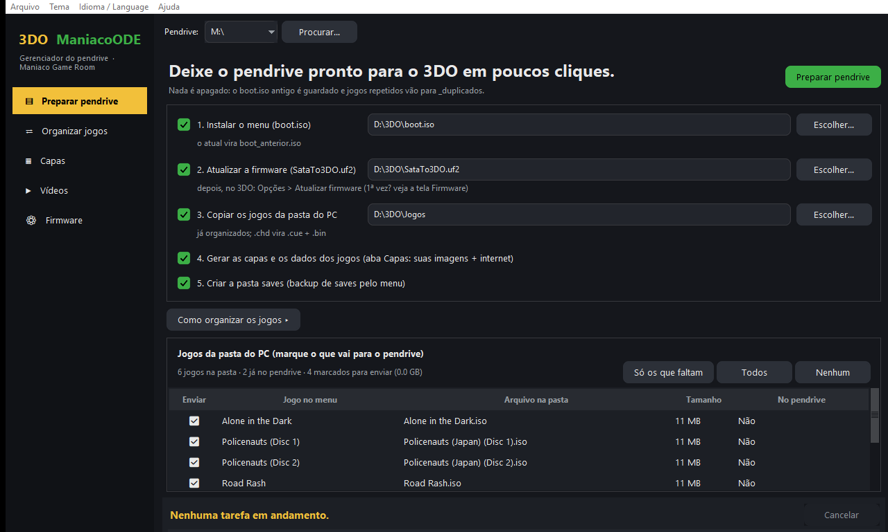
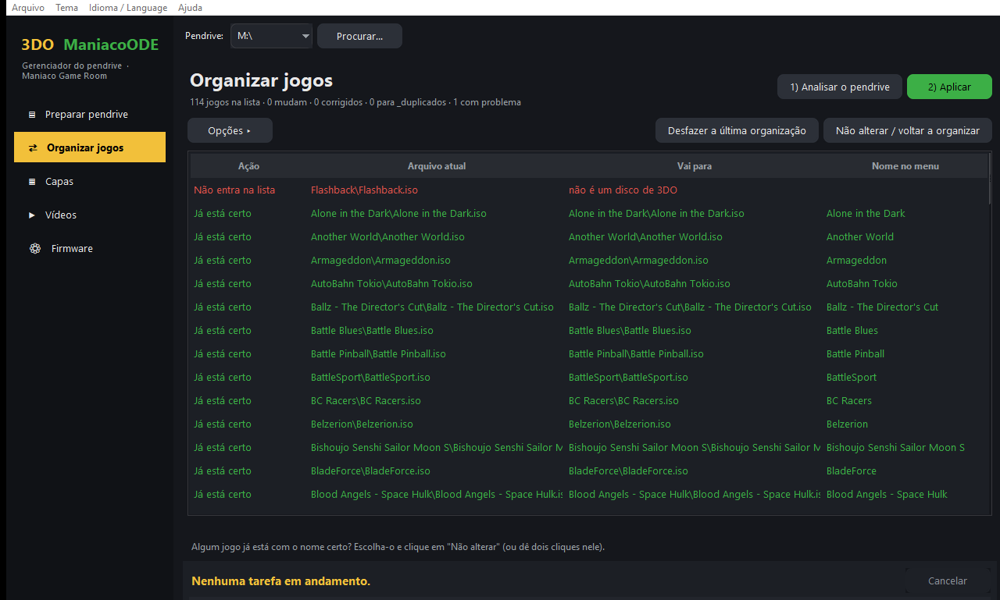
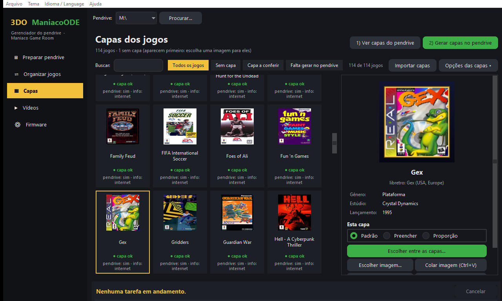
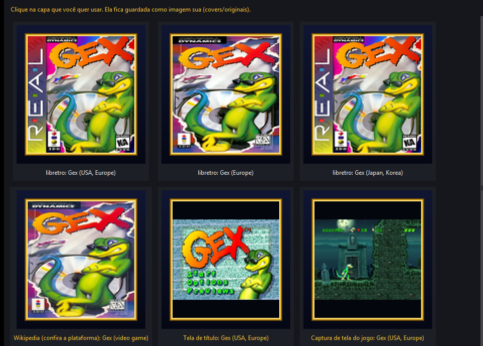
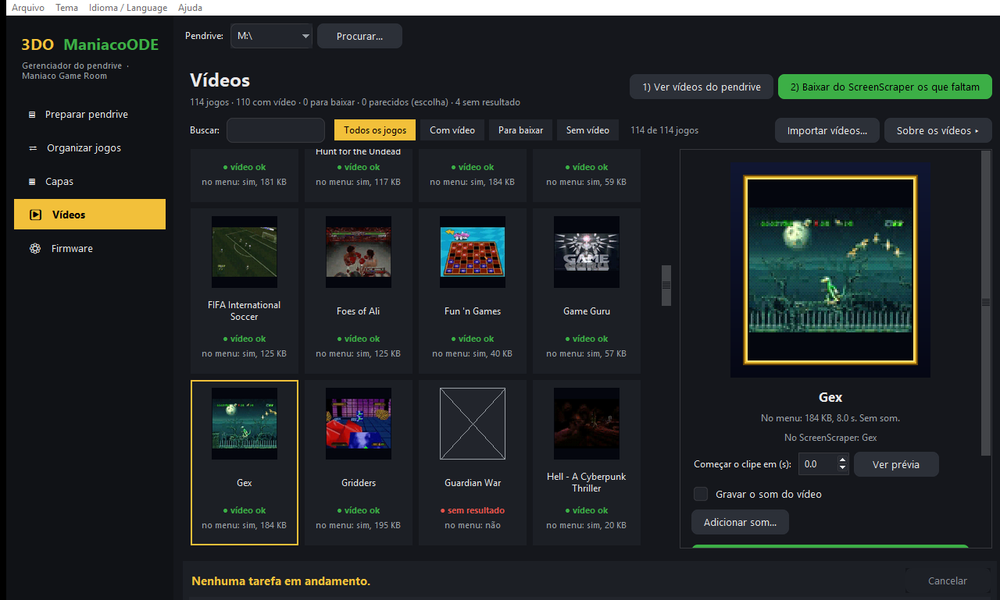
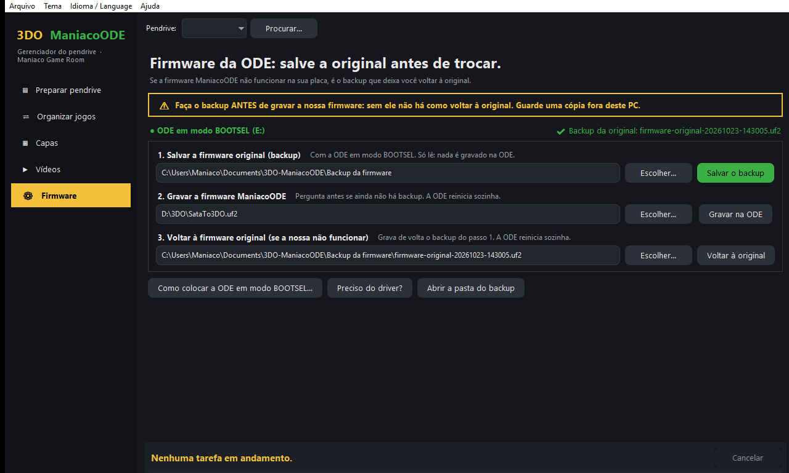
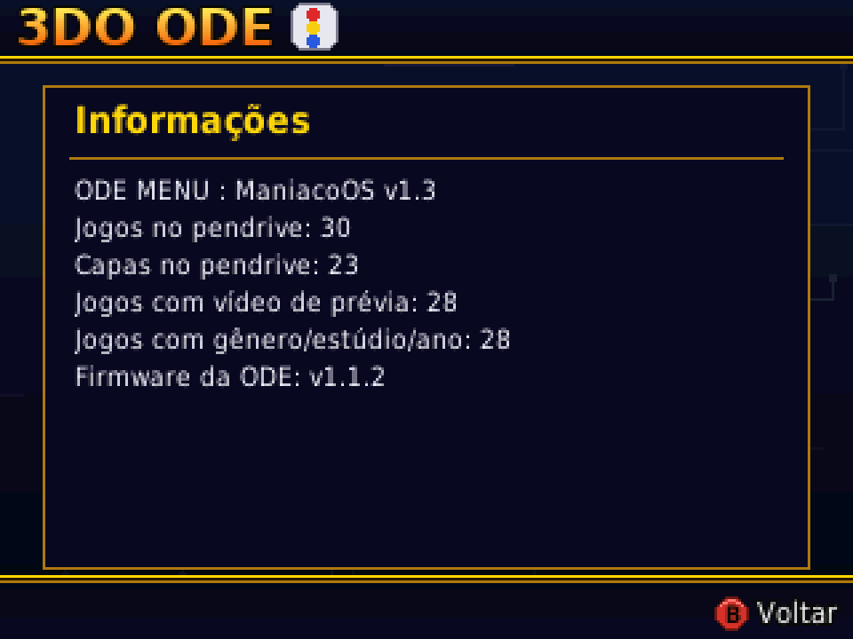

# Manual — 3DO ManiacoODE

**[English](MANUAL.en.md)** · **[Voltar ao início](README.md)**

## Conteúdo

1. [O que você precisa](#1-o-que-você-precisa)
2. [Primeira instalação da firmware](#2-primeira-instalação-da-firmware)
3. [Preparar o pendrive](#3-preparar-o-pendrive)
4. [Programa do PC — Gerenciador do pendrive](#4-programa-do-pc--gerenciador-do-pendrive)
5. [Usando o menu](#5-usando-o-menu)
6. [Opções](#6-opções)
7. [Gerenciador de saves](#7-gerenciador-de-saves)
8. [Memory Unit FZ-EM256](#8-memory-unit-fz-em256)
9. [Atualizar a firmware](#9-atualizar-a-firmware)
10. [Problemas comuns](#10-problemas-comuns)

## 1. O que você precisa

- Um 3DO com a **ODE SataTo3DO** (placa com RP2040) instalada. Testado num **Panasonic FZ-10**.
- Um pendrive em **FAT32** ou **exFAT**.
- Os arquivos da página de **[Releases](../../releases)**:
  - **`SataTo3DO.uf2`** — a firmware da ODE;
  - **`boot.iso`** — o menu;
  - **`3DO-ManiacoODE-Gerenciador.exe`** — o programa do PC que prepara o pendrive (opcional, para **Windows 10 ou 11**).

## 2. Primeira instalação da firmware

> ⚠️ **Antes de gravar a nossa firmware, salve a firmware original da sua ODE.** Se a ManiacoODE não funcionar na sua placa, é o backup que deixa você **voltar à firmware original**. Sem ele, não há como voltar. O programa do PC faz o backup em um clique ([seção 4.8](#48-firmware-da-ode-backup-e-volta-à-original)); guarde uma cópia do arquivo também fora do PC (nuvem ou pendrive).

Só na primeira vez é preciso gravar a firmware pelo PC. O jeito mais fácil é a tela **Firmware** do programa do PC ([seção 4.8](#48-firmware-da-ode-backup-e-volta-à-original)), que faz os três passos abaixo com avisos. À mão:

1. **Modo BOOTSEL.** Com o console **desligado**, ligue o RP2040 da ODE ao PC pelo USB segurando o botão BOOTSEL da placa enquanto conecta. O PC mostra uma unidade chamada **RPI-RP2**.
2. **Backup da original (não pule).** Com a ODE ainda em BOOTSEL, salve a flash inteira com o `picotool` da Raspberry Pi: `picotool save -a firmware-original.uf2`. Confira o arquivo (o `.uf2` tem o dobro da flash: 4 MB numa ODE com 2 MB de flash) e guarde-o em dois lugares. Na tela Firmware do programa, o mesmo passo é o botão **Salvar o backup**.
3. **Gravar a ManiacoODE.** Copie o **`SataTo3DO.uf2`** para a unidade **RPI-RP2**. A placa grava e reinicia sozinha.

Depois disso, as atualizações são feitas pelo pendrive ([seção 9](#9-atualizar-a-firmware)).

**Se a nossa não funcionar na sua placa:** coloque a ODE em modo BOOTSEL de novo e copie o seu `firmware-original-….uf2` (o backup do passo 2) para a unidade **RPI-RP2**. A placa grava e reinicia com a firmware original. Na tela Firmware do programa: **Voltar à original**.

## 3. Preparar o pendrive

O jeito mais fácil é o **programa do PC** ([seção 4](#4-programa-do-pc--gerenciador-do-pendrive)): ele instala o menu, organiza os jogos, gera as capas e cria a pasta de saves em poucos cliques.

Se preferir fazer à mão, organize o pendrive assim:

```
boot.iso                 ← o menu
saves/                   ← pasta para o backup de saves (crie vazia)
Alone in the Dark/
    Alone in the Dark.iso
Gex/
    Gex.iso
Policenauts/
    Policenauts (Disc 1).iso
    Policenauts (Disc 2).iso
```

- **`boot.iso`** fica na raiz. Se já tinha outro menu, renomeie o antigo (ex.: `boot_antigo.iso`) para poder voltar.
- **Cada jogo na sua pasta.** Se a pasta tem um único jogo, o menu mostra o **nome da pasta**; se tem vários arquivos, mostra o nome de cada arquivo.
- Formatos aceitos: **`.iso`** (2048 ou 2352 bytes por setor) e **`.cue` + `.bin`** (um `.bin` só por `.cue`). Jogos em **`.chd`** são convertidos para `.cue` + `.bin` pelo programa do PC ao copiar ([seção 4.2](#42-preparar-pendrive)).
- Jogos com **vários discos**: deixe "Disc 1", "Disc 2"… no nome do arquivo e o menu mostra "(Disco 1)", "(Disco 2)".
- As pastas **`saves`** e **`covers`** não aparecem na lista de jogos.
- As **capas** e os dados dos jogos (gênero, estúdio e ano) são gerados pelo programa do PC.
- **Para mudar o nome de um jogo**, use **Renomear jogo…** no programa do PC ([seção 4.4](#44-capas)). Renomeando a pasta pelo Windows, o jogo continua funcionando (e os saves não se perdem), mas a capa, as informações e a imagem escolhida ficam com o nome antigo até você gerar as capas de novo.
- **Evite renomear ou mover muitas pastas de uma vez na raiz do pendrive.** Na FAT32, cada nome trocado deixa uma entrada apagada no diretório, e a ODE monta a lista de jogos percorrendo esse diretório antes de avisar o 3DO que há disco. Com o diretório cheio de entradas apagadas, o 3DO pode desistir e mostrar a tela dele em vez do menu ([seção 10](#10-problemas-comuns)).

## 4. Programa do PC — Gerenciador do pendrive

O **3DO ManiacoODE — Gerenciador do pendrive** deixa o pendrive pronto para o 3DO: instala o menu, copia a firmware, organiza os jogos do jeito que a ODE lê, gera as capas, grava os vídeos de prévia e cria a pasta de saves.

**Instalação:** não há instalação. Baixe o `3DO-ManiacoODE-Gerenciador.exe` na página de [Releases](../../releases) e abra.

> Na primeira vez, o Windows pode mostrar "O Windows protegeu o computador" (SmartScreen), porque o programa é novo e não tem assinatura paga. Clique em **Mais informações → Executar assim mesmo**.

**Internet:** as capas, os dados e os vídeos dos jogos são baixados na hora de usar e ficam guardados no PC (`%LOCALAPPDATA%\3DO-ManiacoODE`). Da segunda vez em diante, o que já foi baixado funciona sem internet.

**Seu pendrive está seguro:** o programa **não apaga nada**. O `boot.iso` antigo é guardado, jogos repetidos vão para a pasta `_duplicados`, imagens trocadas vão para `covers/originais/_antigas`, e a organização dos jogos pode ser desfeita.

### 4.1 A janela



- **Barra lateral** (esquerda): as cinco telas — **Preparar pendrive**, **Organizar jogos**, **Capas**, **Vídeos** e **Firmware** (backup da firmware original, [seção 4.8](#48-firmware-da-ode-backup-e-volta-à-original)); a que está aberta fica em destaque. Embaixo aparece a situação do pendrive: sistema de arquivos, espaço livre e se o menu está instalado.
- **Pendrive** (topo): escolha a letra do pendrive. O programa sugere primeiro os que já têm o `boot.iso`. Use **Procurar…** se o pendrive não aparecer.
- **Cada tela** tem o título e a **ação principal** (em verde) no canto superior direito. As opções avançadas ficam **recolhidas** atrás de um botão com **▸**: clique para abrir.
- **Rodapé:** mostra a etapa atual, a porcentagem, o tempo que falta e o botão **Cancelar**.
- **Menu Arquivo:** abre o pendrive no Explorer.
- **Menu Tema:** muda as cores da janela (Noite, Menu ManiacoODE (azul e ouro) e Claro). A escolha fica salva.
- **Menu Idioma / Language:** mostra a janela em português ou em inglês. Na primeira vez, o programa usa o idioma do Windows.
- **Menu Ajuda:** **Verificar atualizações…**, **Verificar ao abrir o programa**, blog Maniaco Game Room e Sobre.

**Atualizações do programa:** em **Ajuda → Verificar atualizações…** o programa consulta a última release no GitHub e mostra as novidades. Havendo versão nova, **Baixar e atualizar** baixa o programa, confere o **SHA-256** e, com o seu aval, fecha e troca o arquivo; o antigo fica ao lado como `3DO-ManiacoODE-Gerenciador.exe.anterior`, para você voltar se precisar. **Verificar ao abrir o programa** (desligado por padrão) avisa na barra de status quando sai versão nova. Precisa de internet. Só o programa do PC se atualiza sozinho: o `boot.iso` e a firmware você copia (a firmware também pelas Opções do menu).

### 4.2 Preparar pendrive

Marque o que quer fazer e clique em **Preparar pendrive** (botão verde, no canto superior direito). Cada passo pode ser feito sozinho. As opções de organização dos jogos ficam em **Como organizar os jogos ▸**.

1. **Instalar o menu (`boot.iso`):** aponte o `boot.iso` baixado. O que já estava no pendrive vira `boot_anterior.iso`.
2. **Atualizar a firmware (`SataTo3DO.uf2`):** o programa confere se o arquivo é mesmo uma firmware do RP2040 e copia para a raiz do pendrive. Depois, no 3DO, abra **Opções → Atualizar firmware** ([seção 9](#9-atualizar-a-firmware)).
3. **Copiar os jogos da pasta do PC:** aponte a pasta com os seus jogos (`.iso`, `.cue` + `.bin`, `.chd`). Eles vão para o pendrive já organizados, conforme **Como organizar os jogos** ([seção 4.3](#43-organizar-jogos)). O programa confere se cabe antes de copiar e pula o que já está lá.
4. **Gerar as capas e os dados dos jogos:** usa as opções da aba Capas ([seção 4.4](#44-capas)).
5. **Criar a pasta `saves`:** necessária para o backup de saves no pendrive.

**Jogos da pasta do PC:** assim que você escolhe a pasta, o programa lista os jogos dela e confere o pendrive. Para cada jogo aparecem o **nome no menu**, o arquivo, o tamanho e a coluna **No pendrive**:

- **Já está** — o jogo já está no pendrive, com o mesmo tamanho;
- **Já está (com outro nome)** — o mesmo jogo (e disco) está no pendrive com outro nome ou em outra pasta;
- **Não** — ainda não está no pendrive.

Na coluna **Enviar**, clique para marcar (☑) ou desmarcar (☐). Já vêm marcados só os que faltam; os botões **Só os que faltam**, **Todos** e **Nenhum** ajudam, e o resumo mostra quantos jogos e quantos GB vão. **Preparar pendrive** envia só os marcados.

**Jogos em `.chd`:** são convertidos para `.cue` + **um `.bin` só** (o formato que a ODE lê) direto no pendrive, com o **chdman** do MAME, que vem junto com o programa. O rodapé mostra "Jogo N de M · nome · %". O jogo convertido é conferido antes de ir para a pasta; um `.chd` estragado ou que não é de 3DO aparece no relatório e não deixa arquivo no pendrive. No fim, o programa pergunta se os `.chd` originais do PC vão para a **Lixeira** (dá para recuperar).

O programa só continua se o pendrive estiver em **FAT32** ou **exFAT**. Ao final, a caixa de texto mostra o **relatório** de tudo o que foi feito, inclusive os jogos que ficaram de fora e o motivo.

### 4.3 Organizar jogos



Arruma os jogos que **já estão no pendrive**, com as mesmas regras que a firmware usa para montar a lista.

1. Clique em **Opções ▸** e escolha:
   - **Nomes limpos:** tira região e marcas do nome (`Need For Speed, The (USA) [!]` → `The Need For Speed`);
   - **Pastas:** uma pasta para cada jogo, por letra (A, B, C…) ou manter as pastas atuais;
   - **Mover versões repetidas para `_duplicados`:** deixa só uma cópia de cada jogo. Entre um `.iso` e um `.cue` + `.bin`, fica o `.cue` + `.bin`, que tem o áudio do CD.
2. Clique em **1) Analisar o pendrive**. A lista mostra o que vai acontecer com cada jogo:
   - **Já está certo** — nada muda;
   - **Mover / renomear** — vai para outra pasta e/ou ganha o nome limpo;
   - **Mover p/ `_duplicados`** — cópia repetida (entre cópias iguais, fica a que já está com o nome e a pasta certos);
   - **Tirar .cue antigo** — `.cue` que aponta para um `.iso` de nome antigo, com uma trilha só de dados, cujo jogo está no pendrive: o `.iso` sozinho já é o disco inteiro, então o `.cue` vai para `_duplicados`;
   - **Corrigir o `.cue`** — o `.cue` aponta para um arquivo que não existe ou tem nome de trilha longo demais para a firmware;
   - **Criar o `.cue`** — `.bin` sem `.cue`;
   - **Não entra na lista** — não é um disco de 3DO, ou o `.cue` não tem como ser corrigido.
3. **Algum jogo já está com o nome certo** (um homebrew, por exemplo)? Escolha-o e clique em **Não alterar / voltar a organizar** (ou dê dois cliques nele): ele fica onde está, com o nome atual, também nas próximas análises. Clique de novo para voltar a organizar.
4. Confira e clique em **2) Aplicar**.
5. Mudou de ideia? **Desfazer a última organização** devolve tudo como estava.

Arquivos que a ODE não lê (`.zip`, `.7z`…) aparecem num aviso embaixo da lista: extraia ou converta para `.iso` ou `.cue` + `.bin`. Jogos em `.chd` no pendrive também aparecem nesse aviso: copie-os pela aba **Preparar pendrive**, que converte. As imagens e os modos de capa que você escolheu acompanham o jogo quando ele é renomeado. Depois de aplicar, o programa oferece gerar as capas de novo, porque os nomes mudaram.

### 4.4 Capas



A capa aparece ao lado da lista no menu, numa moldura de 106×116 pixels, com o gênero, o estúdio e o ano do jogo.

1. Clique em **1) Ver capas do pendrive**. Cada jogo vira um **cartão** com a miniatura da capa, o nome e a situação: **capa ok**, **a conferir** (amarelo: capa da Wikipedia, tela de título ou captura de tela, para você conferir) ou **sem capa** (vermelho; esses aparecem primeiro). O cartão também diz se a capa já está no pendrive e de onde vêm as informações (**internet**, **você** ou **falta**). As miniaturas aparecem aos poucos.
2. **Buscar:** digite parte do nome. Os botões **Todos os jogos**, **Sem capa**, **Capa a conferir** e **Falta gerar no pendrive** filtram a grade, e o contador mostra "N de M jogos". As **setas do teclado** andam pela grade.
3. Clique num cartão para ver, à direita, a **prévia na TV** (já dentro da moldura do menu), o **gênero, o estúdio e o lançamento** do jogo e as ações.
4. Clique em **2) Gerar capas no pendrive** para gravar tudo na pasta `covers`.

As opções desta tela ficam recolhidas em **Opções das capas ▸**: como encaixar a capa, a sua pasta de imagens e onde procurar.

**Como encaixar a capa (padrão para todos os jogos):**

- **Preencher a moldura** (recomendado): estica a capa inteira até encher a moldura, sem cortar nada.
- **Manter a proporção:** a capa fica sem esticar, com faixas em volta.

**Esta capa:** no painel da prévia, escolha o modo só do jogo selecionado — **Padrão** (segue a opção acima), **Preencher** ou **Proporção**. Assim umas capas preenchem a moldura e outras mantêm a proporção. O modo escolhido fica guardado no pendrive (`<jogo>.modo`).

**Onde procurar as capas:** o programa usa a primeira que encontrar, nesta ordem:

1. **Suas imagens** — escolhidas na aba Capas ou na **sua pasta de imagens** (opcional; o nome do arquivo é o nome do jogo, em PNG, JPG, WEBP, BMP ou GIF);
2. **libretro-thumbnails** — acervo de capas, com as versões americana, europeia e japonesa;
3. **ScreenScraper** e **TheGamesDB** — só com conta ([seção 4.6](#46-contas-do-screenscraper-e-do-thegamesdb));
4. **Wikipedia** — a imagem do artigo do jogo. **Confira:** às vezes é a caixa de outra plataforma;
5. **Tela de título** do jogo — sempre com a proporção mantida;
6. **Captura de tela do jogo** (libretro) — último recurso, também com a proporção mantida.

As caixas **Usar a Wikipedia…** e **Usar a tela de título ou uma captura do jogo…** ligam ou desligam essas fontes na escolha automática. **Baixar da internet o que faltar** desligada usa só o que já foi baixado antes.

**Trocar a capa de um jogo** (botões do painel da prévia):



- **Escolher entre as capas…** — abre todas as capas encontradas para o jogo (todas as regiões, Wikipedia, tela de título…), já como ficam na TV. Clique na que quiser.
- **Escolher imagem…** — uma imagem do seu PC.
- **Colar imagem (Ctrl+V)** — uma imagem copiada, por exemplo do navegador ("Copiar imagem").
- **Procurar na internet** — abre a busca de imagens no navegador.
- **Voltar à capa automática** — desfaz a troca. A imagem que você tinha escolhido vai para `covers/originais/_antigas`.

A capa escolhida fica guardada no pendrive e é usada nas próximas vezes. Depois de trocar, clique em **2) Gerar capas no pendrive**.

**Importar capas de uma pasta:** o botão **Importar capas…** pega as imagens de uma pasta do PC (por exemplo, uma pasta do EmuMovies, com subpastas) e casa cada uma com um jogo do pendrive pelo **nome**: nome igual, mesmo título sem a região ou nome parecido; entre várias regiões ganha a do jogo, e o "Disco 2" não pega a imagem do "Disco 1". O programa mostra quantos arquivos achou, quantos jogos **já têm capa sua** (ficam como estão) e quantos ficaram sem arquivo, e **só importa se você confirmar**. As imagens vão para `covers/originais`; depois clique em **2) Gerar capas no pendrive**.

**Informações do jogo (gênero, estúdio e lançamento):** o cartão e o painel mostram de onde elas vêm — **internet**, **você** ou **falta**. Para preencher ou corrigir, escolha o jogo e clique em **Informações do jogo…** (ou dê dois cliques no cartão):

- campos **Gênero**, **Gênero em inglês** (usado com o menu em inglês), **Estúdio** e **Lançamento**;
- embaixo, as linhas **como o menu vai mostrar**, com a mesma fonte do 3DO: avisa quando o texto vai ser cortado com "…" e quando há caracteres que o menu não tem (aparecem como "?");
- **Salvar no pendrive** grava na hora, sem precisar gerar as capas de novo. O que você preenche vale mais que a internet; campo deixado vazio usa o da internet;
- **Usar o da internet** volta às informações automáticas (as suas vão para `covers/originais/_antigas`).

**Renomear jogo…:** muda o nome que o menu mostra. O programa renomeia a pasta do jogo (ou o arquivo, se o nome vem do arquivo) e leva junto a capa, a imagem escolhida, o modo da capa e as informações. O jogo renomeado fica marcado como **Não alterar** no Organizar, para o nome escolhido não ser trocado depois.

### 4.5 Vídeos



Parado num jogo, o menu toca um clipe curto e sem som no lugar da capa. **Precisa do menu v1.2 ou mais novo** (o menu v1.1 ignora os vídeos); no 3DO, dá para desligar em **Opções → Prévia em vídeo**.

1. Clique em **1) Ver vídeos do pendrive**. Cada jogo vira um **cartão** com um quadro do vídeo que já está no menu e a situação: **vídeo ok**, **para baixar** (o mesmo nome existe no **ScreenScraper**), **sem resultado** ou **sem vídeo** (ainda não consultado). Os botões **Todos os jogos**, **Com vídeo**, **Para baixar** e **Sem vídeo** e o campo **Buscar** filtram a grade. **Sobre os vídeos ▸** mostra os limites e a licença.
2. Clique em **2) Baixar do ScreenScraper os que faltam**: o programa consulta a lista de jogos do site (não precisa de conta), mostra quantos vídeos vai baixar e grava no pendrive os dos jogos sem vídeo que têm o mesmo nome no site. Os **parecidos** ficam para você escolher.
3. Clique num cartão para ver, à direita, a **prévia animada**, do jeito que o menu mostra, dentro da moldura, e o que o ScreenScraper achou para o jogo.

**Um jogo de cada vez** (botões do painel da prévia):

- **Procurar no ScreenScraper…** — mostra os jogos do site parecidos com o nome; dá para procurar com outro nome. Escolha um e clique em **Usar este**.
- **Usar vídeo do computador…** — qualquer vídeo do PC (`.mp4`, `.mkv`, `.avi`, `.webm`, `.mov`…), por exemplo uma gravação do seu console.
- **Começar o clipe em (s)** e **Ver prévia** — escolha em que segundo do vídeo o clipe começa e veja como fica antes de gravar; **Aplicar com este início** grava. Os vídeos do ScreenScraper começam em 3 s, para pular a entrada.
- **Tirar o vídeo do menu** — o vídeo sai do menu; o original vai para `covers/originais/_antigas` (não é apagado).

Todo vídeo é convertido para o limite seguro do menu: 104 pixels de largura, 15 quadros por segundo, até 8 segundos e cerca de 200 KB. O vídeo original fica guardado em `covers/originais` (de 1 a 10 MB cada), para dar para mudar o início depois.

**Importar vídeos de uma pasta:** **Importar vídeos…** faz o mesmo que as capas: pega os vídeos de uma pasta do PC (por exemplo, clipes do EmuMovies), casa pelo nome com os jogos do pendrive, mostra o resumo e, com o seu aval, converte cada um para o menu (alguns segundos por jogo). Quem já tem vídeo fica como está.

**Som (em teste):** o menu v1.2 toca a prévia **sem som**. O programa já sabe gravar o som do clipe junto do vídeo (mono, 11025 Hz, cerca de 88 KB a mais), para um menu futuro que toque som, mas isso vem **desligado**: a caixa **Gravar o som do vídeo** do painel liga. **Adicionar som…** refaz com som os vídeos que já estão no pendrive (do original guardado ou baixando de novo do ScreenScraper). Com o menu v1.2 não há vantagem em ligar: os bytes a mais só deixam o vídeo um pouco mais lento para carregar.

> Os vídeos do ScreenScraper têm licença Creative Commons BY-NC-SA: só para uso pessoal, sem fins comerciais.

### 4.6 Contas do ScreenScraper e do TheGamesDB

Opcional. Com estas contas, o programa também procura capas no **ScreenScraper** e no **TheGamesDB** quando o libretro não tiver. Abra pelo botão **Contas (ScreenScraper, TheGamesDB)…** da aba Capas.

- **ScreenScraper:** precisa de uma **credencial de desenvolvedor** (pedida à equipe do site) e, de preferência, da **sua conta** no site (usuário e senha), que dá mais acessos por dia.
- **TheGamesDB:** precisa de uma **chave de API**, pedida no fórum do site.
- **Testar** confere as contas sem fechar a janela; **Salvar** guarda.
- As senhas e a chave ficam **só neste computador**, protegidas pelo Windows.

Se a conta for recusada ou a cota do dia acabar, o programa para de usar aquela fonte até ser aberto de novo e segue com as outras.

### 4.7 O que o programa grava no pendrive

| No pendrive | O que é |
|---|---|
| `boot.iso` | o menu |
| `boot_anterior.iso` | o menu que estava antes |
| `SataTo3DO.uf2` | a firmware nova, até ser aplicada (vira `.ok` ou `.erro`) |
| `saves/` | backup de saves feito pelo menu |
| `covers/` | capas (`.cap`), vídeos de prévia (`.vid`, com o som se você gravou), dados dos jogos (`dados.cap`) e a lista das capas e dos vídeos (`indice.cap`) |
| `covers/originais/` | as imagens que você escolheu, o modo de cada capa (`<jogo>.modo`), as informações preenchidas à mão (`<jogo>.info`), os vídeos originais e o início de cada clipe (`<jogo>.inicio`) |
| `covers/originais/_antigas/` | imagens e vídeos que você trocou ou tirou |
| `_duplicados/` | versões repetidas tiradas da lista |
| `.maniacoode/` | o registro para **Desfazer a última organização** e os jogos marcados **Não alterar** (`nao_alterar.json`) |

### 4.8 Firmware da ODE: backup e volta à original



> ⚠️ **Salve a firmware original antes de gravar a nossa.** É o backup que deixa você voltar à firmware da ODE se a ManiacoODE não funcionar na sua placa. O programa avisa se você tentar gravar sem ele.

A tela **Firmware** (última da barra lateral) trabalha com a ODE ligada ao PC em **modo BOOTSEL** (a unidade **RPI-RP2** aparece). O aviso no alto da tela mostra se o programa a enxergou (**● ODE em modo BOOTSEL**) e se já há um backup (**✔ Backup da original**).

1. **Salvar a firmware original (backup).** **Salvar o backup** lê a flash inteira da ODE (só lê: nada é gravado nela) e salva `firmware-original-AAAAMMDD-HHMMSS.uf2`, mais um `.txt` com os dados da placa e o **SHA-256**, na pasta que você escolher (padrão: **Documentos\3DO-ManiacoODE\Backup da firmware**). O programa confere a leitura, marca os arquivos como somente leitura e nunca sobrescreve um backup anterior. **Guarde uma cópia fora do PC.** Se a ODE já estiver com a firmware ManiacoODE, o programa avisa: o arquivo salvo **não** é a original e não conta como backup.
2. **Gravar a firmware ManiacoODE.** Escolha o `SataTo3DO.uf2` e clique em **Gravar na ODE**. Se ainda não houver backup, o programa pergunta antes (resposta padrão: não). A ODE reinicia sozinha ao terminar; depois, desconecte o USB do PC. Nas próximas vezes, atualize pelo menu do 3DO ([seção 9](#9-atualizar-a-firmware)).
3. **Voltar à firmware original.** Se a nossa não funcionar, coloque a ODE em BOOTSEL de novo, escolha o backup (o programa já sugere o último) e clique em **Voltar à original**. O programa só aceita um backup de flash inteira que não seja a firmware ManiacoODE.

Os botões **Como colocar a ODE em modo BOOTSEL…** e **Preciso do driver?** mostram o passo a passo.

**Driver (só para o backup):** para salvar o backup, o programa fala direto com a placa pelo USB (usa o `picotool` da Raspberry Pi, que vai junto no `.exe`), e o Windows pode precisar do driver **WinUSB** para essa porta. Se a unidade RPI-RP2 aparece mas o backup diz que falta o driver: baixe o **Zadig**, com a ODE em BOOTSEL abra **Options → List All Devices**, escolha **RP2 Boot (Interface 1)**, o driver **WinUSB**, e clique em **Install Driver**. É uma vez só. **Gravar** e **Voltar à original** não precisam do driver: só copiam o arquivo para a unidade RPI-RP2.

> **Não desligue a ODE nem tire o USB durante a gravação** (poucos segundos). Se algo der errado, a placa continua podendo entrar em BOOTSEL: basta repetir. Nunca conecte o USB do PC com o console ligado.

## 5. Usando o menu

Ao ligar o console, toca a **abertura em vídeo** escolhida em **Opções → Abertura** (A, B, C, X ou Start pula) e o menu abre com **todos os jogos em ordem alfabética**, com a capa e os dados do jogo escolhido.

| Botão | Na lista de jogos |
|---|---|
| **▲ ▼** | sobe e desce na lista |
| **L / R** (ou **◄ ►**) | pula uma tela inteira de jogos |
| **A** (ou **Start**) | inicia o jogo |
| **X** | abre as **Opções** |

Parado num jogo que tem **vídeo de prévia** no pendrive ([seção 4.5](#45-vídeos)), depois de alguns segundos o vídeo toca no lugar da capa; mexer na lista volta para a capa.

Quando você escolhe um jogo, o 3DO reinicia e carrega o disco. Para voltar ao menu, desligue e ligue o console.

## 6. Opções

| | |
|---|---|
|  |  |

| Item | O que faz |
|---|---|
| **Tamanho da tela** | Diminui o menu de 100 % até 80 %, em passos de 5 %, para TVs que cortam as bordas. Ajuste com **◄ ►**. |
| **Idioma / Language** | Textos do menu em português ou em inglês. Troque com **◄ ►**. |
| **Prévia em vídeo** | Liga ou desliga o vídeo de prévia no lugar da capa ([seção 4.5](#45-vídeos)). Troque com **◄ ►**. |
| **Abertura** | Vídeo que toca ao ligar o console: um dos quatro (ManiacoOS1, ManiacoOS2, ManiacoOS3, 3DO), **Aleatória** ou **Desligada**. Troque com **◄ ►**; vale a partir da próxima vez que ligar. |
| **Gerenciar saves** | Abre o gerenciador de saves (**A**). |
| **Atualizar firmware** | Grava a `SataTo3DO.uf2` do pendrive ([seção 9](#9-atualizar-a-firmware)). |
| **Informações** | Abre (**A**) a tela com a versão do menu, a versão da firmware da ODE e quantos jogos, capas, vídeos de prévia e jogos com gênero/estúdio/ano há no pendrive. |

Embaixo das Opções aparecem a versão do menu e a da firmware da ODE. **▲ ▼** escolhem o item; **B** volta para a lista. O tamanho da tela, o idioma, a prévia em vídeo e a abertura ficam salvos na memória do 3DO (NVRAM) ao voltar.

## 7. Gerenciador de saves


O gerenciador tem três abas, trocadas com **L / R**:

| Aba | O que mostra |
|---|---|
| **Console** | os saves da memória interna do 3DO (NVRAM) e o espaço livre |
| **Memory Unit** | os saves da Memory Unit FZ-EM256, se estiver conectada |
| **Pendrive** | o backup de saves na pasta `saves` do pendrive |

Escolha um save e aperte **A** para ver as ações:

- **Copiar para o pendrive / para o Memory Unit / para o console**;
- **Restaurar no console / no Memory Unit** (na aba Pendrive);
- **Apagar** (ou **Tirar do backup**, na aba Pendrive);
- **Copiar todos para o pendrive** / **Restaurar todos no console**.

Apagar, substituir e restaurar todos pedem confirmação. **B** volta.

> A aba **Pendrive** só funciona se existir a pasta **`saves`** na raiz do pendrive. Se ela não existir, o menu avisa.

## 8. Memory Unit FZ-EM256

- **Conecte e desconecte a Memory Unit somente com o console desligado.** Com o console ligado, o 3DO trava.
- Com a unidade conectada, o console liga normalmente no menu e os jogos funcionam.
- A aba **Memory Unit** procura a unidade quando é aberta. Se ela não estiver conectada, aparece "Memory Unit não encontrado".
- O menu **não formata** a Memory Unit: só monta a unidade para ler e gravar saves.

## 9. Atualizar a firmware

Depois da primeira instalação, não é mais preciso abrir o console.

### Pelo menu (firmware v1.1 em diante)

1. Copie o **`SataTo3DO.uf2`** novo para a **raiz** do pendrive (ou use o passo 2 do programa do PC).
2. Ligue o console e abra **Opções → Atualizar firmware**. A ODE confere o arquivo ("Conferindo o arquivo...").
3. Aparece **"Atualizar para vX.Y.Z?"**. Aperte **A** para gravar ou **B** para cancelar.
4. Quando aparecer **"Firmware gravada. Desligue o console e ligue de novo."**, desligue e ligue o console. A nova versão aparece em **Opções → Informações**.

O arquivo é renomeado para **`SataTo3DO.uf2.ok`** depois de gravado. Outras respostas:

- **"Nenhuma atualização no pendrive"** — o `SataTo3DO.uf2` não está na raiz;
- **"A firmware já está nesta versão."** — nada é gravado (o arquivo vira `.ok`);
- **"Arquivo inválido (renomeado para .erro)."** — o arquivo está corrompido ou não é a firmware da ODE; a firmware atual continua funcionando.

> **Não desligue o console durante a gravação.**

### Voltar à firmware original

Voltar à firmware original só é possível pelo PC, em modo BOOTSEL, com o backup que você salvou antes da primeira gravação ([seção 2](#2-primeira-instalação-da-firmware) e [seção 4.8](#48-firmware-da-ode-backup-e-volta-à-original)).

### Vindo da v1.0

A firmware v1.0 não atualiza pelo menu (as Opções mostram "Firmware da ODE: original"). Para passar para a v1.1, copie o `SataTo3DO.uf2` para a raiz do pendrive e **ligue o console**: a v1.0 grava o arquivo sozinha ao ligar (o LED do Pico fica aceso alguns segundos) e a ODE reinicia. Daí em diante, use o menu.

### Socorro: se o menu não abrir

Copie a firmware para a raiz do pendrive com o nome **`SataTo3DO_forcar.uf2`** e ligue o console: esse arquivo é gravado ao ligar, sem passar pelo menu. O LED do Pico fica aceso enquanto grava; **5 piscadas devagar** = arquivo recusado. O arquivo vira `.ok` ou `.erro`, como no menu.

> Se faltar energia bem na gravação final (cerca de 2 segundos), regrave pelo PC em modo BOOTSEL ([seção 2](#2-primeira-instalação-da-firmware)).

## 10. Problemas comuns

| Problema | Solução |
|---|---|
| **As bordas do menu ficam cortadas na TV** | Opções → **Tamanho da tela** → diminua para 95 % ou 90 %. |
| **Um jogo não aparece na lista** | Use **Organizar jogos** no programa do PC: ele mostra o motivo e corrige `.cue` quebrado ou sem par. À mão: confira a extensão (`.iso`, `.cue`) e se o nome em `FILE "…"` do `.cue` é igual ao arquivo da pasta. |
| **Um jogo está sem capa** | No programa do PC, aba Capas: **Escolher entre as capas…**, **Escolher imagem…** ou **Colar imagem**, depois **Gerar capas no pendrive**. |
| **A capa veio de outra plataforma** | Acontece com a Wikipedia. Use **Escolher entre as capas…** ou uma imagem sua. |
| **A capa ficou esticada demais** | Em **Esta capa**, escolha **Proporção** para esse jogo e gere as capas de novo. |
| **"O Windows protegeu o computador"** | **Mais informações → Executar assim mesmo** (o programa não tem assinatura paga). |
| **A aba Pendrive avisa para criar a pasta** | Crie a pasta **`saves`** na raiz do pendrive (ou use o passo 5 do programa do PC). |
| **"Memory Unit não encontrado"** | Desligue o console, conecte a Memory Unit e ligue de novo. |
| **O arquivo virou `SataTo3DO.uf2.erro`** | O arquivo está corrompido ou não é a firmware da ODE. Baixe de novo na página de Releases. |
| **Depois de organizar ou renomear muitas pastas, o 3DO mostra a tela dele em vez do menu** | O diretório do pendrive ficou cheio de entradas apagadas e a lista demora demais para ficar pronta. Refaça o pendrive: copie tudo para uma pasta do PC, formate o pendrive em **FAT32** e copie de volta. |
| **Renomeei a pasta de um jogo e a capa sumiu** | A capa e as informações ficaram com o nome antigo. Use **Renomear jogo…** no programa do PC; se já renomeou pelo Windows, renomeie também os arquivos de `covers/originais` e clique em **Gerar capas no pendrive**. |
| **A firmware ManiacoODE não funcionou na minha placa** | Volte à original: ODE em modo BOOTSEL e **Voltar à original** na tela Firmware do programa (ou copie o seu `firmware-original-….uf2` para a unidade RPI-RP2). [Seção 4.8](#48-firmware-da-ode-backup-e-volta-à-original). |
| **Não salvei o backup antes de gravar** | Sem o backup não há como voltar ao arquivo exato da sua placa. Peça a firmware original ao vendedor ou fabricante da sua ODE (ou ao projeto SataTo3DO) e grave-a em modo BOOTSEL. Daqui em diante, salve o backup antes de qualquer gravação pelo PC. |
| **O backup diz que falta o driver, ou "não achei a ODE"** | Confira se a unidade **RPI-RP2** aparece (modo BOOTSEL, console desligado). Se aparece e o backup ainda falha, instale o driver WinUSB com o Zadig (**Preciso do driver?** na tela Firmware). |
| **Quero voltar ao menu anterior** | Apague o `boot.iso` e renomeie o `boot_anterior.iso` (ou o antigo) de volta para `boot.iso`. |
