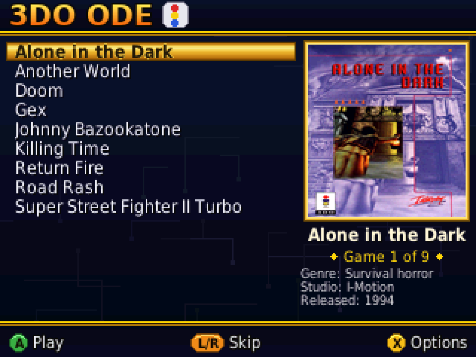
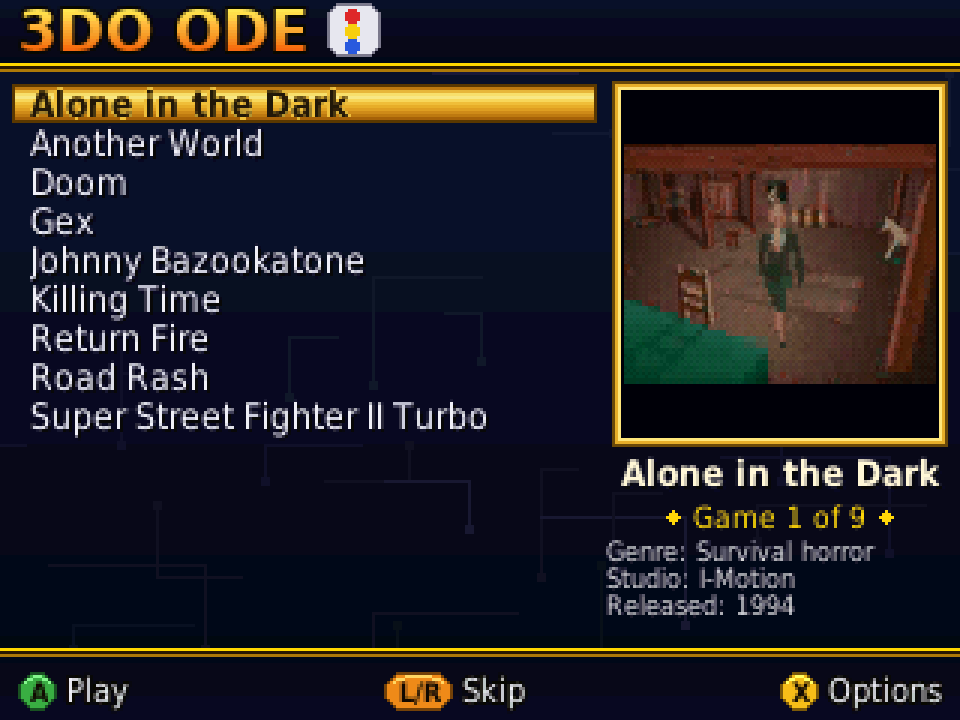
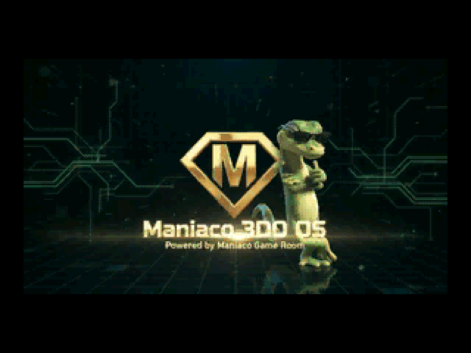
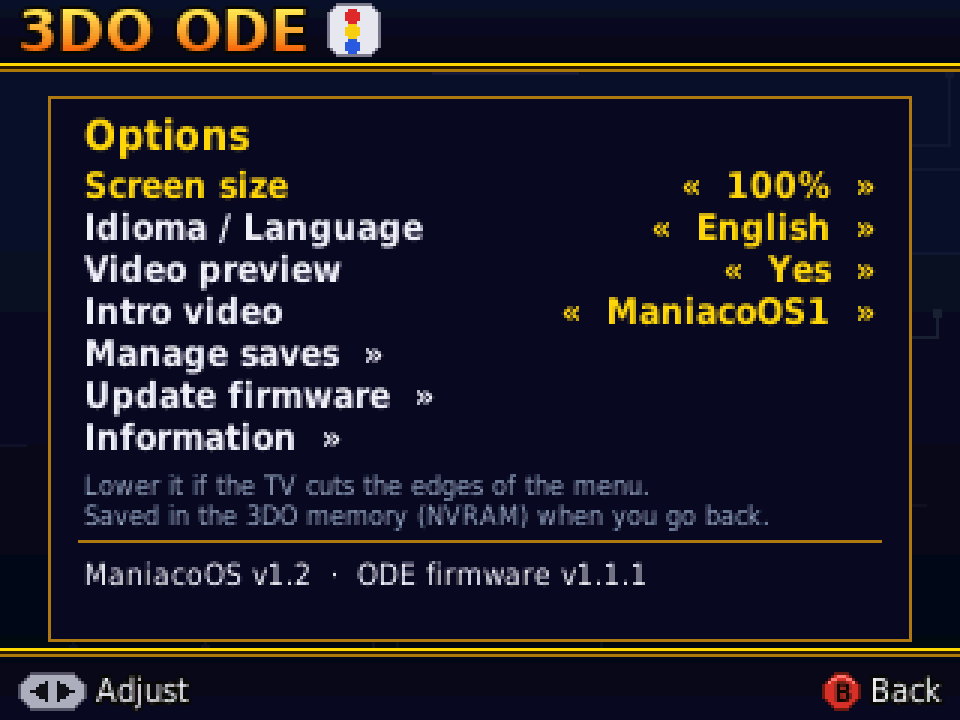
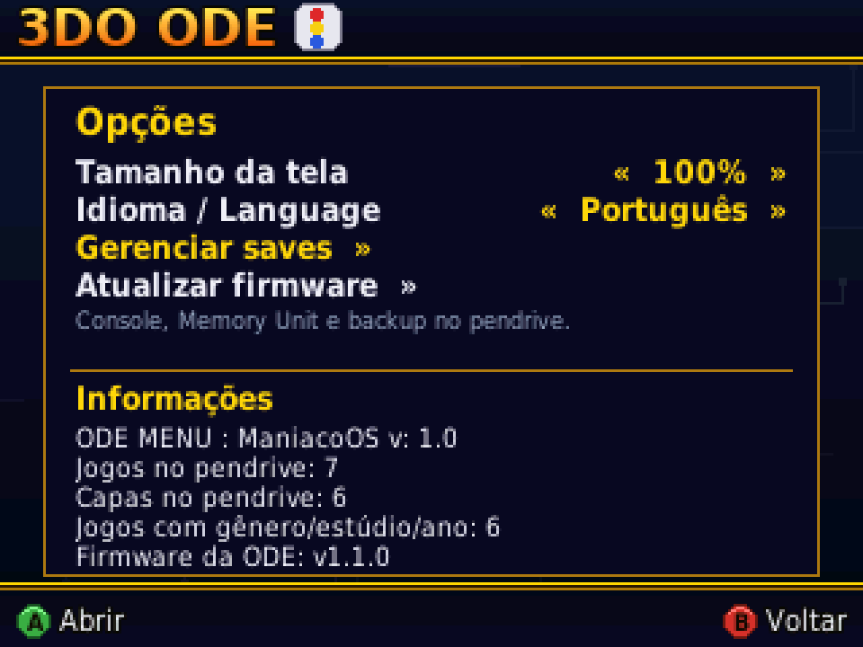
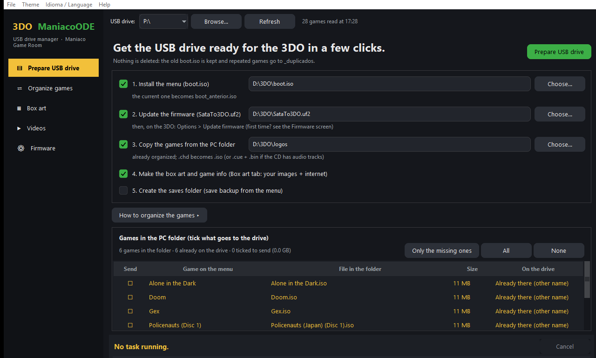
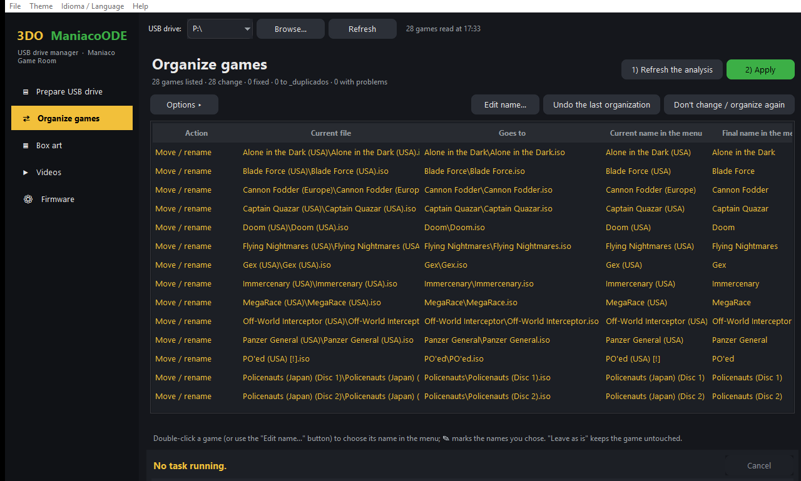
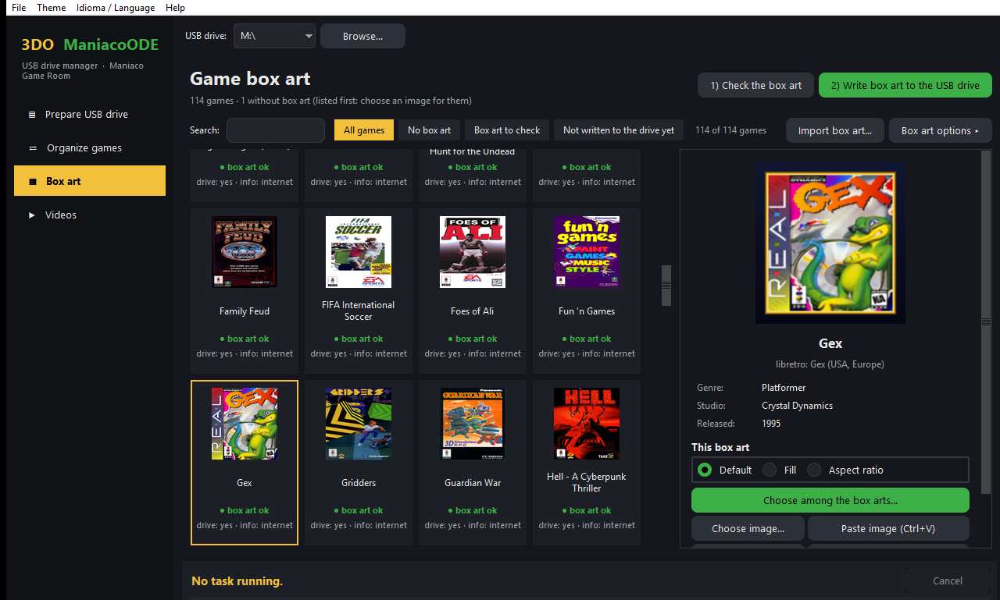

# 3DO ManiacoODE

**[Português](README.md)**

**New firmware and a new menu for the 3DO SataTo3DO ODE: a Portuguese or English menu with a video intro, box art and info for every game, every game on the USB drive in alphabetical order, a save manager (console, Memory Unit and USB drive), FZ-EM256 Memory Unit support and firmware updates from the menu itself — plus a PC program that gets the USB drive ready in a few clicks.**

A **[Maniaco Game Room](https://www.maniacogameroom.com.br/)** blog project.

## What 3DO ManiacoODE brings

| | |
|---|---|
|  |  |
|  |  |

### Menu (`boot.iso`)

- **Menu in Portuguese**, with accents (á, ã, ç, é…), or **in English** (Options → Idioma / Language).
- **Video intro** when the console is turned on, chosen in the Options: four intros, random or off. A, B, C, X or Start skips it.
- **Video preview with sound:** resting on a game, a clip of the game plays in place of the box art, with sound (videos written by the PC program); picture and sound are turned off separately in the Options.
- **Every game on the USB drive in one alphabetical list**, no folder browsing. **L/R** skips a full screen of games.
- **Box art for every game** next to the list, with **genre, studio and year**.
- **Multi-disc** games are labeled: "Title (Disc 1)", "Title (Disc 2)".
- **Screen size** from 80 % to 100 %, for TVs that crop the edges. Saved in the 3DO memory.
- **Save manager** with three tabs — **Console**, **Memory Unit** and **USB drive**: copy, restore, delete and copy all at once. Back up your console saves to the USB drive.
- **Update firmware** from the Options, with the ODE firmware version shown in Information.

### Firmware (`SataTo3DO.uf2`)

- **Alphabetical list** of every game, in any folder of the USB drive.
- **Updates from the USB drive:** after the first flash, you never need to open the console or connect the ODE to a PC again. Copy `SataTo3DO.uf2` to the USB drive and use **Options → Update firmware**.
- **Big collections (v1.1.2):** the 3DO is released right away and the list is built while the menu loads; tested with 164 games (before, big collections gave a black screen after the 3DO logo).
- **FZ-EM256 Memory Unit:** the console boots with the unit plugged in, and the menu and games work normally.
- **Saves on the USB drive:** file read and write from the menu.

## The PC program: USB drive manager

With the USB drive in the PC, a few clicks:

1. installs the **menu** (`boot.iso`) and copies the **firmware** (`SataTo3DO.uf2`);
2. shows the **games in your folder** and which ones are **already on the drive**, and copies only the ones you tick, already organized the way the ODE reads them, with **clean names** and one folder per game — or **by region** (`USA`, `JP`, `EU`), for those who keep a full set;
3. **converts `.chd` games** while copying: they become an **`.iso`** (smaller, checked sector by sector) or `.cue` + `.bin` when the CD has audio tracks;
4. **fixes broken `.cue` files**, creates the missing ones and removes leftover old ones;
5. makes the **box art** and game info (genre, studio and year), which you can also **fill in by hand**;
6. writes the games' **video previews** (from ScreenScraper, no account needed, or your own video);
7. **imports box art and videos from a folder** on the PC (for example from EmuMovies), matching them by game name;
8. creates the **`saves`** folder;
9. **saves your ODE's original firmware (backup)** before you flash ours and **goes back to it** if ManiacoODE does not work on your board (**Firmware** screen), and **installs the USB driver** the backup needs, with no hunting around the internet.

New look: a **sidebar**, a **box art grid** with search and filters, a game panel and collapsed options. The drive is **read only once** and the Organize, Box art and Videos screens are already filled in, with no extra click (**Refresh** button when you need it); nothing that writes or processes files comes ticked when it opens. The program **updates itself from GitHub** (Help → Check for updates…).

Box art comes from **libretro-thumbnails**, **Wikipedia** and, with an account, **ScreenScraper** and **TheGamesDB**. You see a **preview of how it looks on the TV**, choose among every box art found or use your own image, and decide **box art by box art** whether it fills the frame or keeps its aspect ratio.

The program works in **Portuguese or English** (Idioma / Language menu) and also organizes a USB drive that is already set up — with the option to **not change** a game that already has the right name, or to **pick by hand the name** it will have in the menu — and **renames games** taking along their box art, info and video. **Nothing is deleted:** whatever is replaced is kept, and the organization can be undone.

| | |
|---|---|
|  |  |

## How to use

1. Download **`SataTo3DO.uf2`**, **`boot.iso`** and **`3DO-ManiacoODE-Gerenciador.exe`** from the **[Releases](../../releases)** page.
2. **First time — save the original firmware before flashing ours:** open the program, go to the **Firmware** screen, put the ODE in BOOTSEL mode and click **Save the backup**. Only then click **Flash to the ODE** with `SataTo3DO.uf2`. If ours does not work on your board, **Go back to the original**. After that, updates go through the 3DO menu.
3. Open the program, pick the USB drive and click **Prepare USB drive**. (Prefer doing it by hand? See the [Manual](MANUAL.en.md#3-preparing-the-usb-drive).)
4. Put the USB drive in the ODE, turn on the console and pick a game.

Full step-by-step guide with every option: **[Manual](MANUAL.en.md)**.

## Requirements

- A 3DO with the **SataTo3DO ODE** (RP2040 board). Tested on a **Panasonic FZ-10**.
- USB drive formatted as **FAT32** or **exFAT**.
- Games as **`.iso`** or **`.cue` + `.bin`**.
- PC program: **Windows 10 or 11**, with internet the first time (box art and game info are downloaded and kept on the PC).

## Warning

**Before flashing our firmware, save your ODE's original one** (the program's **Firmware** screen, [Manual](MANUAL.en.md#2-first-firmware-install)): the backup is what lets you go back to it if ManiacoODE does not work on your board. Keep a copy of the file outside the PC too.

**Never plug or unplug the Memory Unit while the console is on** — the 3DO bus does not support it and the console locks up. Plug it in with the console off. Games and BIOS files are not provided.

## License

**Freeware — free to use. © 2026 Maniaco Game Room. All rights reserved.** See the [license](LICENCA.md) and the [third-party components](TERCEIROS.md).

Found a problem? Open an [Issue](../../issues).
