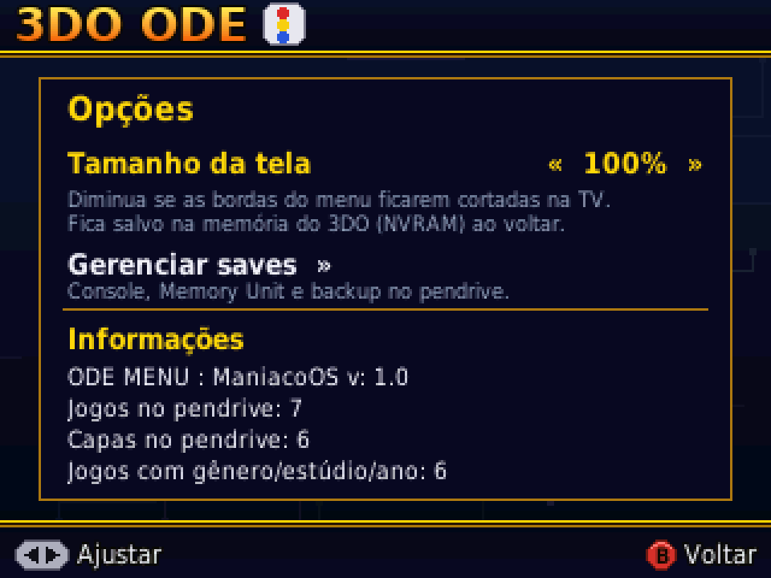

# 3DO ManiacoODE

**[English](README.en.md)**

**Firmware nova e menu novo para a ODE SataTo3DO do 3DO: menu em português com abertura em vídeo, todos os jogos do pendrive em ordem alfabética, gerenciador de saves (console, Memory Unit e pendrive), compatibilidade com a Memory Unit FZ-EM256 e atualização da firmware pelo próprio pendrive.**

Um projeto do blog **[Maniaco Game Room](https://www.maniacogameroom.com.br/)**.

## O que o 3DO ManiacoODE traz

| | |
|---|---|
|  |  |

### Menu (`boot.iso`)

- **Menu inteiro em português**, com acentos (á, ã, ç, é…).
- **Abertura em vídeo** ao ligar o console. A, B, C, X ou Start pula.
- **Todos os jogos do pendrive numa lista só, em ordem alfabética**, sem precisar entrar em pastas. **L/R** pula uma tela inteira de jogos.
- Jogos com **vários discos** aparecem identificados: "Título (Disco 1)", "Título (Disco 2)".
- **Tamanho da tela** de 80 % a 100 %, para TVs que cortam as bordas. Fica salvo na memória do 3DO.
- **Gerenciador de saves** com três abas — **Console**, **Memory Unit** e **Pendrive**: copiar, restaurar, apagar e copiar todos de uma vez. Faça backup dos saves do console no pendrive.

### Firmware (`SataTo3DO.uf2`)

- **Lista em ordem alfabética** de todos os jogos, em qualquer pasta do pendrive.
- **Atualização pelo pendrive:** depois da primeira gravação, nunca mais precisa abrir o console nem ligar a ODE no PC. Copie o `SataTo3DO.uf2` para o pendrive e ligue o 3DO.
- **Memory Unit FZ-EM256:** o console liga com a unidade conectada e o menu e os jogos funcionam normalmente.
- **Saves no pendrive:** leitura e gravação de arquivos pelo menu.

## Como usar

1. Baixe o **`SataTo3DO.uf2`** e o **`boot.iso`** na página de **[Releases](../../releases)**.
2. **Primeira vez:** grave o `SataTo3DO.uf2` no RP2040 da ODE pelo PC (modo BOOTSEL). Das próximas vezes, a atualização é pelo pendrive.
3. Copie o **`boot.iso`** para a raiz do pendrive (guarde o anterior com outro nome, se quiser voltar).
4. Crie uma pasta **`saves`** na raiz do pendrive, para o backup de saves.
5. Coloque cada jogo na sua pasta, ligue o console e escolha o jogo.

Passo a passo completo, com todas as opções: **[Manual](MANUAL.md)**.

## Requisitos

- 3DO com a **ODE SataTo3DO** (placa com RP2040). Testado num **Panasonic FZ-10**.
- Pendrive em **FAT32** ou **exFAT**.
- Jogos em **`.iso`** ou **`.cue` + `.bin`**.

## Aviso

**Nunca conecte nem desconecte a Memory Unit com o console ligado** — o barramento do 3DO não aceita isso e o console trava. Conecte com ele desligado. Jogos e BIOS não são fornecidos.

## Licença

**Freeware — uso gratuito. © 2026 Maniaco Game Room. Todos os direitos reservados.** Veja a [licença](LICENCA.md) e os [componentes de terceiros](TERCEIROS.md).

Encontrou um problema? Abra uma [Issue](../../issues).
